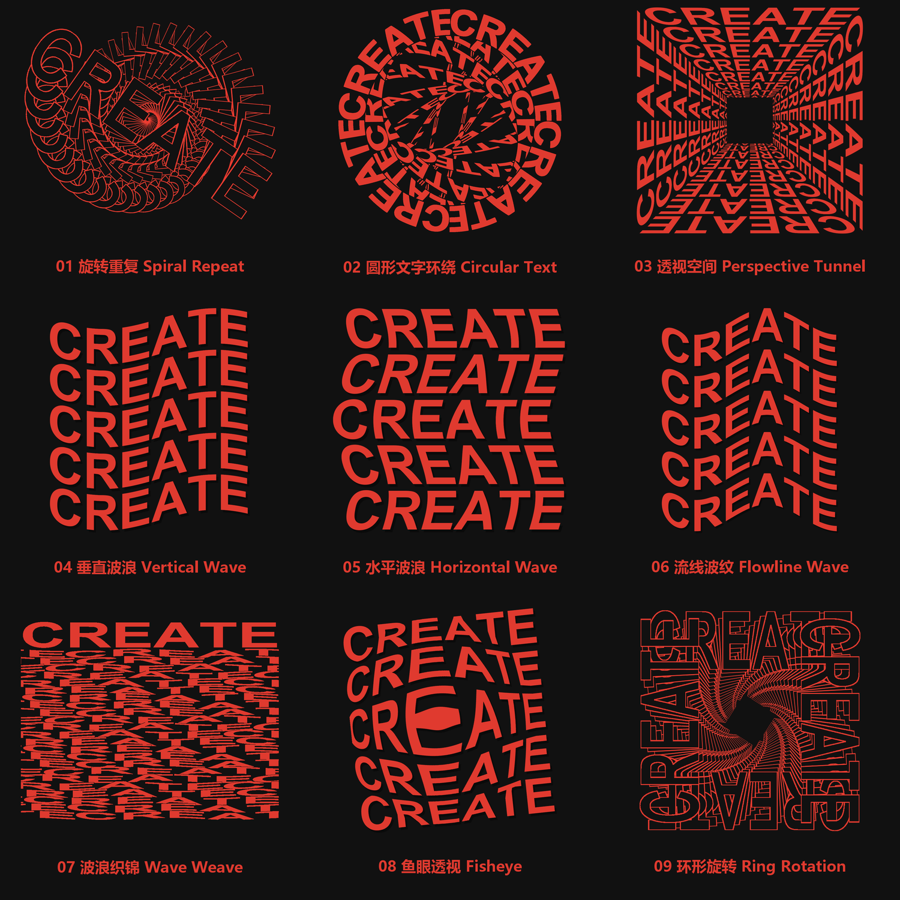
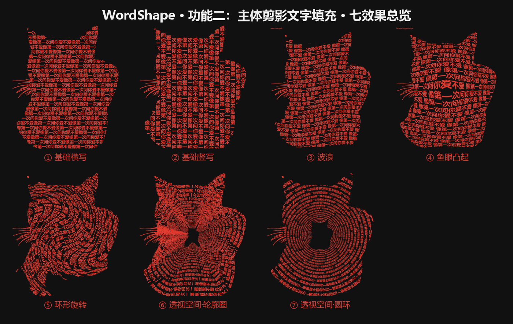

# WordShape 文字塑形排印 · 使用说明书

[English README](README.md) | [中文 README](README.zh-CN.md)

> 一句话：**把文字变成图形，再把文字填进图形。**
> 全部由本地代码绘制，不调用 AI 生图、不消耗生图额度、无水印、每次结果一致。

本文是「用户视角」的使用说明，适合通过聊天式助手调用；命令行用法见 [README.zh-CN.md](README.zh-CN.md)。

---

## 目录

1. [这个工具能做什么](#一这个工具能做什么)
2. [功能一：文字复制与变形](#二功能一文字复制与变形)
3. [功能二：主体剪影文字填充](#三功能二主体剪影文字填充)
4. [怎么跟我提需求（对话示例）](#四怎么跟我提需求对话示例)
5. [配色规则](#五配色规则)
6. [疏密调节](#六疏密调节)
7. [素材要求](#七素材要求)
8. [常见问题](#八常见问题)

---

## 一、这个工具能做什么

WordShape 有两个独立功能，共用同一套文字渲染底座：

| 功能 | 输入 | 输出 |
|---|---|---|
| **功能一 · 文字复制与变形** | 一段文字 | 文字被复制、弯折、透视、环形排布后的图形 |
| **功能二 · 主体剪影文字填充** | 一张主体图 + 一段文字 | 文字填满主体轮廓的透明 PNG |

输出都是 **PNG 图片**，默认红色文字 `#E03A2F`；功能一默认透明底，功能二固定透明底。可以叠到任何背景上使用。

---

## 二、功能一：文字复制与变形

*九种效果一览：01 旋转重复 / 02 圆形文字环绕 / 03 透视空间 / 04 垂直波浪 / 05 水平波浪 / 06 流线波纹 / 07 波浪织锦 / 08 鱼眼透视 / 09 环形旋转*

### 九个效果

| 编号 | 名称 | 长什么样 |
|---|---|---|
| 01 | **旋转重复** | 文字围绕中心缩放+旋转复制 25 份，形成密集涡旋，最前一层原字清晰可见 |
| 02 | **圆形文字环绕** | 文字沿圆周弯排成环，再旋转复制 8 层，像一圈圈同心圆环 |
| 03 | **透视空间** | 多行文字做成四面透视墙，向中心收缩成隧道，中间留空 |
| 04 | **垂直波浪** | 多行文字沿纵向连续起伏，像旗帜飘动 |
| 05 | **水平波浪** | 多行文字沿横向错位弯曲 |
| 06 | **流线波纹** | 多行文字沿同一条平滑曲线流动，行行错落 |
| 07 | **波浪织锦** | 顶部一行正常字，下方二十多条薄波浪带交织成纹理（文字可读性低，适合做底纹） |
| 08 | **鱼眼透视** | 凸透镜效果，中间放大外鼓、边缘压缩，整体略微上斜 |
| 09 | **环形旋转** | 文字排成方框，方框嵌套旋转复制 20 层，中心旋出空洞 |

> 想看效果长什么样，直接说「**有哪些效果**」，会发一张 9 格总览图（也就是上面这张）。

### 用法

只要说一句「**文字 + 效果名**」就行：

- 「把 KEEP GOING 做成鱼眼效果」
- 「『我爱你』用圆形文字环绕」
- 「这段字做成流线波纹」——不指定就默认第一个效果

命令行等价写法：`python -m wordshape text "KEEP GOING" -o out.png --effect fisheye`

---

## 三、功能二：主体剪影文字填充

*七种效果一览：① 基础横写 / ② 基础竖写 / ③ 波浪 / ④ 鱼眼凸起 / ⑤ 环形旋转 / ⑥ 透视空间·轮廓圈 / ⑦ 透视空间·圆环*

### 七个效果

| 编号 | 名称 | 说明 |
|---|---|---|
| ① | **基础横写**（默认） | 文字像作文一样从左到右、写完一行接着下一行，填满整个剪影 |
| ② | **基础竖写** | 文字像竖排书一样从上到下、写完一列接着下一列（从右往左换列） |
| ③ | **波浪** | 字沿纵向正弦起伏，带轻微横向错位 |
| ④ | **鱼眼凸起** | 中间文字明显放大、四周缩小，像从球面凸出来 |
| ⑤ | **环形旋转** | 越靠外扭转越大，外圈文字顺着圆弧转，中心保持可读 |
| ⑥ | **透视空间·轮廓圈** | 沿主体轮廓一圈圈向内写，每圈都是轮廓的缩小版，中心收出同形空洞 |
| ⑦ | **透视空间·圆环** | 正圆一圈圈向内写，中心直接扣出一个主体轮廓形状的空洞 |

> 说「**有哪些效果**」会拿到一张 7 格总览图（也就是上面这张）。

### 排版规则（决定了它长什么样）

- **作文式连续书写**：全文是一条不断句的字符流，写满一行接下一行，不会每行重新起头
- **允许切字**：轮廓边缘的字会被裁掉一部分，这是贴合轮廓的代价
- **形状优先**：一行里如果有几段分离区域（比如左右耳朵、身体两侧），每段都接着写同一个文本流
- **细部保形**：胡须、发丝这类极细的地方会缩小字号塞进去，细到放不下字的线条直接用红色涂出来补形
- **内部细节勾勒**：眼镜框、瞳孔、花纹这类内部深色细线会自动检测并描出来，不会被文字淹没

命令行等价写法：`python -m wordshape fill subject.png "文字" -o out.png --layout v --effect wave`

---

## 四、怎么跟我提需求（对话示例）

### 功能一

> 「把『向前走』做成透视空间」
> 「你好世界，鱼眼透视，白底黑字」
> 「这段英文做波浪织锦，给我一张 9 效果的合集」

### 功能二

> 「把这段话填进这张图的轮廓里：今天也要加油鸭」—（附一张图，默认基础横写）
> 「竖着写」
> 「用鱼眼凸起，字密一点」
> 「换透明底白字」

---

## 五、配色规则

功能一有 9 种输出模式：

| 模式 | 背景 | 文字 |
|---|---|---|
| **透明底红字** | 透明 | 红 `#E03A2F`（默认） |
| 黑底红字 | `#111111` | 红 |
| 红底白字 | 红 | 白 |
| 透明白字 | 透明 | 白 |
| 透明黑字 | 透明 | 黑 |
| 白底黑字 | 白 | 黑 |
| 黑底白字 | 黑 | 白 |
| 藏青底青字 | `#0A1F33` | 青 `#4FE0E6` |
| 自定义 | 你指定 | 你指定 |

**首次使用会问你一次想要哪种，选完记住，以后不再问。** 想换默认配色，说「换个默认配色」重新选；只想这一次换色，直接说「这次要白底黑字」。

功能二默认红字透明底，想换色直接给颜色值（如「字用金黄色」）。

---

## 六、疏密调节

**功能一**：文字太长建议缩小字号（说「字小一点」）。

**功能二**：三个参数配合，通常只调第一个：

| 说法 | 作用 |
|---|---|
| 「行数多一点 / 密一点」 | 横排=行数增加，竖排=列数增加 |
| 「字大一点 / 稀一点」 | 字号基准变大 |
| 「字缝小一点」 | 行间距收紧 |

---

## 七、素材要求

功能二需要主体图，按优先级：

1. **最好：透明底 PNG** —— 直接用透明通道，最准
2. **次选：纯色/近似纯色背景** —— 自动分割主体
3. **复杂背景** —— 建议先抠图，或直接给一张蒙版图

⚠️ 银器、玻璃、白墙前的主体与背景太接近时，自动分割可能缺边，这种情况请先抠图。

---

## 八、常见问题

**Q：为什么输出是透明底，看不到背景？**
A：这是设计如此——输出是素材，叠到海报、封面、视频里用。想看效果可以加个底色。

**Q：为什么剪影看起来像"文字块"而不是清晰的图形？**
A：剪影填充的本质就是文字铺满形状，远看识形、近看全是字。主体细节越丰富（毛发、耳朵、手指），形状越容易辨认；大色块造型（如方块人）辨识度会低一些。

**Q：能给英文/日文/韩文用吗？**
A：可以，任意语言。英文会自动保留单词间距，中文日文韩文无缝连写。

**Q：同一个效果再跑一次，结果会变吗？**
A：不会。纯代码确定性输出，同输入必出同图，可以放心反复重跑调参。

**Q：会消耗 AI 生图额度吗？**
A：不会。全部是本地图像计算，秒级出图，不调用任何生图模型。

**Q：功能一的效果为什么有时字看不清？**
A：这类效果本身就是"密集图形"，比如 01 旋转重复 25 层叠在一起，靠描边和遮挡关系形成涡旋。想更可读可以减层数或加大字号。

---

*WordShape · 文字塑形排印 · 说明书 v1.0*
